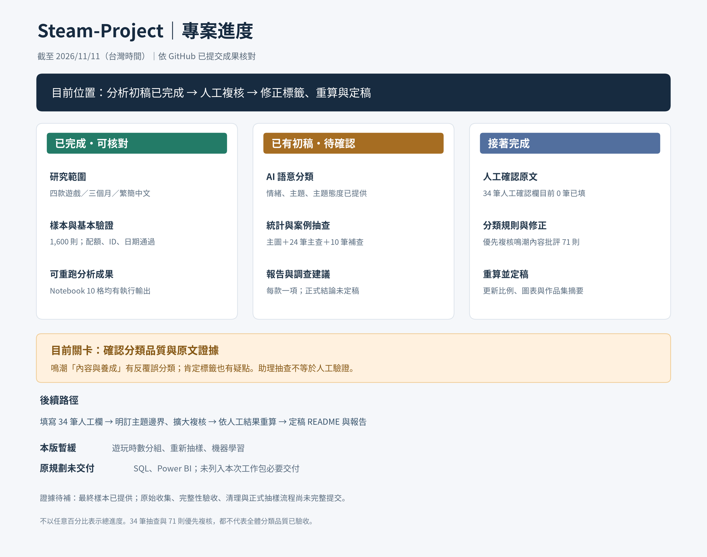

# Steam 中文玩家體驗分析

以 Overwatch、Apex Legends、鳴潮、燕雲十六聲為例，辨識產品痛點，提出產品企劃與 QA 團隊可驗證的優先調查建議。

本專案為個人資料分析作品集。目前已提交 1,600 則樣本、可重跑 Notebook、圖表與分析初稿，正進入人工複核階段，尚未定稿正式研究結論。SQL 與 Power BI 為原規劃中尚未交付的項目。

[查看目前進度與下一步](docs/PROJECT_STATUS.md)｜[閱讀分析初稿](deliverables/steam_analysis_v02/results/analysis_report.md)｜[下載成果 ZIP](deliverables/Steam_Experience_Analysis_v02.zip)

## 專案目的

1. 找出每款遊戲反覆出現的體驗問題，以及值得保留的優點。
2. 以評論原文確認主要發現是否有證據支持。
3. 本版先為每款遊戲提出一項有數據與原文支持的優先調查事項。

遊玩時數分組、重新抽樣與機器學習於本版暫緩；原規劃的每款三項建議保留為後續擴充。

成果使用者為遊戲產品企劃及 QA 測試團隊。商業價值在於縮小排查範圍、提供決策依據。調查順序參考問題提及比例、時間變化及是否阻礙遊玩，並保留人工判斷依據；提及次數不直接等同實際嚴重程度。

## 研究對象

| 分組 | 遊戲 | Steam App ID |
|---|---|---:|
| 多人競技射擊 | Overwatch | 2357570 |
| 多人競技射擊 | Apex Legends | 1172470 |
| 開放世界動作 RPG | 鳴潮 | 3513350 |
| 開放世界動作 RPG | 燕雲十六聲 | 3564740 |

主要結論針對各款遊戲分別提出。跨遊戲比較提供探索性參考，不將兩款遊戲視為整個類型的代表。

## 資料範圍

- 來源：Steam 公開玩家評論，透過官方 IUserReviewsService/GetAppReviews 介面取得。
- 第一版語言：繁體中文（tchinese）、簡體中文（schinese）。
- 研究期間：台灣時間 2026/08/01 00:00:00 至 2026/10/31 23:59:59，以評論建立時間篩選。
- 包含推薦與不推薦評論，不強制正負評各半。
- 查詢包含所有取得遊戲方式，啟用 Steam 離題活動過濾；結果代表此查詢設定下取得的評論。
- 保留原文、Steam 語言標記、評論 ID、建立與更新時間、推薦狀態及評論當時的遊玩分鐘。
- 英文、日文、韓文保留為後續延伸方向，不納入第一版正式分析。

原始評論先分頁保存至 Google Drive，通過收集與品質檢查後，再建立清理版、分析樣本與 CSV。原始收集筆數與最終分析樣本數分開記錄。

## 抽樣規劃

第一版目標共 1,600 則有效文字評論：

| 遊戲 | 繁體中文暫定配額 | 簡體中文暫定配額 | 合計目標 |
|---|---:|---:|---:|
| Overwatch | 164 | 336 | 500 |
| Apex Legends | 46 | 454 | 500 |
| 鳴潮 | 177 | 123 | 300 |
| 燕雲十六聲 | 207 | 93 | 300 |
| **合計** | **594** | **1,006** | **1,600** |

語言配額依前期盤點比例暫定，不是已完成抽樣的實際筆數。清理空白、重複及期間外資料後，依各款有效評論筆數重新計算。若不足目標則全取並記錄缺額，不重複抽取湊數。

抽樣程序：

1. 各款內按繁簡體有效評論比例分配目標筆數。
2. 各語言內再按三個月份的有效評論比例分配並隨機抽樣；月份以台灣時間計算。
3. 整數配額使用最大餘數法分配，確保總數符合目標且不超過各組可用筆數。
4. 固定隨機種子 42，抽樣前穩定排序，並保存規則、資料版本與抽樣評論 ID。
5. 不按推薦狀態強制配置正負評比例。
6. 檢查抽樣前後的月份、繁簡體、推薦狀態與遊玩時數分布，記錄偏差。

繁簡體主要用於控制抽樣組成，不作為第一版核心比較題目。跨遊戲比較使用比例並呈現樣本數；不直接以四款合併的 1,600 則代表整體市場。若計算跨遊戲或取整後分組的整體估計，須說明估計對象並評估是否需要加權。

## 遊玩時數分析（原規劃；本版暫緩）

使用「評論當時的遊玩時數」，不以收集當下的累計時數替代。原始分鐘另換算成小時。

| 分組 | 評論當時遊玩時數 |
|---|---|
| 短時數 | 未滿 10 小時 |
| 中時數 | 10 至未滿 100 小時 |
| 長時數 | 100 小時以上 |
| 缺漏或無效 | 缺值、無法轉換或負值，另行標記 |

先檢視各款分布，再確認切點是否適合；若調整，須在正式比較前記錄理由。第一版將時數作為分析與分布檢查欄位，不另加入固定時數配額，避免「月份 × 語言 × 時數」分組過細。

短時數不直接稱為新手。Steam 記錄可能包含掛機，且不涵蓋其他啟動器、手機或主機上的遊玩經驗。

## 資料品質與評論分類守則

- 檢查八個遊戲與語言組別的完成狀態。走到分頁結尾後，仍須核對實際唯一筆數與盤點差異，記錄完整性檢查結果。
- 依「遊戲 ID＋評論 ID」檢查重複，保存處理紀錄。
- 檢查語言標記、日期、空白文字、推薦狀態與遊玩時數。
- 原始資料保留不覆寫；空白評論排除於文字分析。若納入推薦狀態統計，需另列分母與排除規則。
- Steam 語言標記不保證全文語言一致，保留原文並檢查混用語言。
- 分開保存「Steam 推薦狀態」「評論主題」「文字情緒」「人工複核標記」，不直接把正評等同正面文字。
- 一則評論可有多個主題；同一主題在同一評論只計一次，因此主題比例總和可能超過 100%。
- 保留「無具體主題」及「不確定／待複核」，不強行判斷反諷或模糊內容。
- 候選主題包括效能、當機、連線、配對、平衡、操作與介面、教學、內容與養成、付費、語言與在地化、整體體驗，依試讀修訂定義。
- 先建立人工標記樣本及分類規則；若使用關鍵字或 AI 輔助分類，須以人工標記資料檢查品質並記錄方法。

## 工具與保存方式

| 工具 | 用途 |
|---|---|
| Google Colab／Python／pandas | 資料取得、清理、抽樣及探索分析 |
| Google Drive | 分頁原始資料、收集進度、清理資料與 CSV |
| SQL | 可重現的統計查詢 |
| Power BI | 玩家體驗互動儀表板 |
| GitHub | README、Notebook、SQL、分類規則與報告的版本管理 |

目前 Google Drive 收集位置：`Steam-Project/data/raw/reviews_20260801_20261031`。

Drive 資料與 Colab 程式不會自動同步 GitHub，需另行確認提交內容。不提交金鑰或個人憑證。

## 預計成果

- 資料來源、查詢設定、完整性檢查與清理紀錄。
- 抽樣配額、固定種子及抽樣前後分布比較。
- 評論分類規則、人工標記與分類品質檢查。
- SQL 查詢與 Power BI 玩家體驗儀表板。
- 每款遊戲一頁報告：主要痛點、值得保留的優點、三項優先調查建議、測試方向及仍缺少的證據。

## 研究限制

- 結果描述指定期間與查詢條件下的 Steam 中文評論者，不代表所有平台或所有玩家。
- 繁簡體不代表玩家國籍或所在地。
- 玩法、營運階段與評論者組成不同，跨遊戲差異不能直接歸因於遊戲類型。
- 小樣本分組僅作描述，須呈現筆數，不對微小差異下強結論。
- 未提及某問題不表示玩家未遇到；文字分類也可能誤判。
- 玩家回報須實際重現與驗證，才能確認是否為 Bug。
- 月份或版本更新前後的變化不直接證明因果關係。
- 公開評論無法直接證明流失率、留存率或營收損失；建議成效須用後續測試及內部資料驗證。

## 目前進度

更新日期：2026/11/11（台灣時間）。完整狀態、檔案證據與延後項目見 [進度總覽](docs/PROJECT_STATUS.md)。

### 已完成並提交

- [x] 確定四款遊戲、三個月與繁簡中文研究範圍。
- [x] 提供 1,600 則分析樣本（500／500／300／300）。
- [x] 核對樣本配額、App ID、評論 ID 唯一性、必要欄位與研究日期。
- [x] 提供 AI 初步語意標籤與評論×主題統計。
- [x] 產出主要批評面向圖、正反回饋並列表與分析報告初稿。
- [x] 完成助理原文抽查 24 筆及鳴潮內容面向補查 10 筆；人工確認另欄留白。
- [x] 提出每款一項優先調查事項，保留數據、案例與下一步查證動作。
- [x] 提交已執行 Notebook、分析程式、README 摘要初稿與成果 ZIP。

以上完成代表資料／初稿已交付，**不代表 AI 標籤已通過人工驗證**。

### 目前待完成

- [ ] 由使用者人工確認 34 筆抽查紀錄，目前人工確認結果為 0／34。
- [ ] 明訂主題邊界，優先完整複核鳴潮「內容與養成」71 則批評，追蹤其他標籤疑點。
- [ ] 根據人工確認結果重算主題統計、更新圖表與調查建議。
- [ ] 完成正式作品集結論與成果摘要。
- [ ] 補上原始收集、完整性驗收、清理與正式抽樣的可重現紀錄；最終 CSV 本身不足以驗收整個資料流程。

### 本版範圍之外

- 遊玩時數分組、重新抽樣、機器學習：暫緩。
- SQL 與 Power BI：原計畫包含，目前未提交，不列為本次工作包完成條件。
- 每款三項建議：原規劃；本版先完成每款一項。
