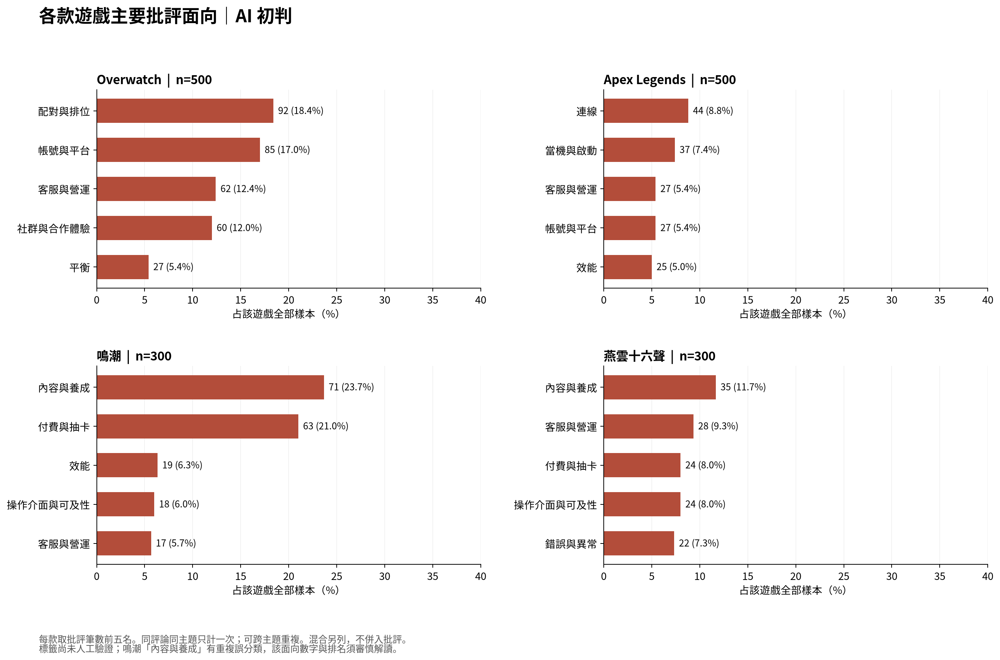
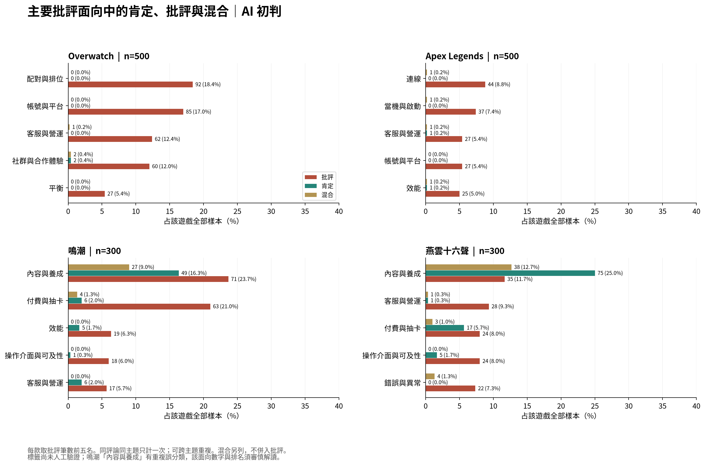

> **人工確認更新：** 使用者已完成 34 筆抽查，全部支持原標籤，統計數字不變。[查看人工確認結果與判讀差異](../human_review/README.md)。以下為人工確認前的分析初稿，原助理觀察與歷史狀態保留。

# Steam 中文玩家體驗分析｜v0.2 工作包成果

**狀態：AI 初判統計＋助理原文抽查；尚未完成人工驗證。** 原始資料與標籤保持不變。

## 研究問題與範圍

各款評論者肯定／批評哪些體驗，以及營運團隊可先查什麼？本版使用使用者提供的 1,600 則樣本：Overwatch 500、Apex Legends 500、鳴潮 300、燕雲十六聲 300。建立時間限定台灣時間 2026/08/01–2026/10/31。語言是 Steam 繁簡中文標記，不保證原文全為中文。未重新抽樣、未做時數分組或機器學習；平均時數圖不納入主要結論。

## 驗證結果

- 1,600 列、35 欄；配額與 App ID 相符，評論 ID 全部唯一；必要分析欄無缺值，原文無空白。人工確認欄留白屬預期。
- 建立時間：2026-08-01 05:26:12+08:00 至 2026-10-31 23:37:07+08:00；月份與台灣時間一致。
- 同遊戲同文字但不同評論 ID 共 133 列額外重複，保留，不以文字去重。檔案本身不能證明帳號獨立性或來源真實性。
- 9 則評論於研究期後更新（Overwatch 4、Apex 1、鳴潮 2、燕雲 2）；只有收集時原文，無法還原研究期末版本。主分析保留，另附排除這九則的敏感度表。
- 分析適用性：921 則可作產品語意分析、564 則僅情緒／語氣參考、115 則無法判讀產品體驗。679 則無具體主題；主題占比仍以各款全部樣本為分母。
- 原始人工狀態全為未驗證。來源 SHA-256：`05cfe2fda17b17fcabc18d71d686fba53058ac9906f94b1a9ade3a34e142e088`。

## 計數方法

解析「各主題態度_AI」，核對其主題集合與「主題_AI」一致。每個遊戲＋評論 ID＋主題只計一次；態度衝突會停止。批評只計「批評」，肯定只計「肯定」；「混合」「中性提及」「不確定」另列，不把整體負面情緒或 Steam 不推薦推成每個主題都負面。
占比＝該款符合目標態度的評論×主題筆數／該款全部樣本。跨主題可重複，總和可能超過 100%；不以有效資訊數或批評評論數改分母，不合併四款推論市場。前五名按筆數遞減，同筆數按主題字串排序。

## 主要批評面向

| 遊戲 | 批評面向_AI | 筆數 | 占該遊戲全部樣本 |
| --- | --- | --- | --- |
| Apex Legends | 連線 | 44 | 8.8% |
| Apex Legends | 當機與啟動 | 37 | 7.4% |
| Apex Legends | 客服與營運 | 27 | 5.4% |
| Apex Legends | 帳號與平台 | 27 | 5.4% |
| Apex Legends | 效能 | 25 | 5.0% |
| Overwatch | 配對與排位 | 92 | 18.4% |
| Overwatch | 帳號與平台 | 85 | 17.0% |
| Overwatch | 客服與營運 | 62 | 12.4% |
| Overwatch | 社群與合作體驗 | 60 | 12.0% |
| Overwatch | 平衡 | 27 | 5.4% |
| 燕雲十六聲 | 內容與養成 | 35 | 11.7% |
| 燕雲十六聲 | 客服與營運 | 28 | 9.3% |
| 燕雲十六聲 | 付費與抽卡 | 24 | 8.0% |
| 燕雲十六聲 | 操作介面與可及性 | 24 | 8.0% |
| 燕雲十六聲 | 錯誤與異常 | 22 | 7.3% |
| 鳴潮 | 內容與養成 | 71 | 23.7% |
| 鳴潮 | 付費與抽卡 | 63 | 21.0% |
| 鳴潮 | 效能 | 19 | 6.3% |
| 鳴潮 | 操作介面與可及性 | 18 | 6.0% |
| 鳴潮 | 客服與營運 | 17 | 5.7% |

**鳴潮「內容與養成」71 則／23.7% 是原 AI 標籤統計，已發現反覆誤分類，不能據此認定內容問題最多。所有主題數字仍是待人工驗證的描述。**

## 肯定與批評並列

燕雲十六聲「內容與養成」有肯定 75／300（25.0%）、批評 35／300（11.7%）、混合 38／300（12.7%）；不能單以批評面向排名描述整體口碑。鳴潮同面向肯定 49／300（16.3%）、批評 71／300（23.7%）、混合 27／300（9.0%），但其標籤邊界有問題，兩側比例都需複核。

各款 AI 肯定面向前五名如下；只列明確的主題肯定，不把籠統「好玩」補成玩法或內容。

| 遊戲 | 肯定面向_AI | 筆數 | 占該遊戲全部樣本 |
| --- | --- | --- | --- |
| Apex Legends | 操作與戰鬥 | 15 | 3.0% |
| Apex Legends | 內容與養成 | 10 | 2.0% |
| Apex Legends | 美術與音樂 | 4 | 0.8% |
| Apex Legends | 社群與合作體驗 | 3 | 0.6% |
| Apex Legends | 付費與抽卡 | 2 | 0.4% |
| Overwatch | 內容與養成 | 7 | 1.4% |
| Overwatch | 美術與音樂 | 6 | 1.2% |
| Overwatch | 操作與戰鬥 | 4 | 0.8% |
| Overwatch | 付費與抽卡 | 2 | 0.4% |
| Overwatch | 效能 | 2 | 0.4% |
| 燕雲十六聲 | 內容與養成 | 75 | 25.0% |
| 燕雲十六聲 | 美術與音樂 | 51 | 17.0% |
| 燕雲十六聲 | 操作與戰鬥 | 28 | 9.3% |
| 燕雲十六聲 | 付費與抽卡 | 17 | 5.7% |
| 燕雲十六聲 | 社群與合作體驗 | 7 | 2.3% |
| 鳴潮 | 美術與音樂 | 57 | 19.0% |
| 鳴潮 | 內容與養成 | 49 | 16.3% |
| 鳴潮 | 操作與戰鬥 | 11 | 3.7% |
| 鳴潮 | 付費與抽卡 | 6 | 2.0% |
| 鳴潮 | 客服與營運 | 6 | 2.0% |

可支持肯定的具體案例（目的選例，另於 evidence_examples.csv 保留全文，不屬 24 筆隨機抽查）：Apex 237431132「战斗爽」；Overwatch 237241641 喜歡新模式並希望常駐；燕雲 232274254 描述自行規劃採藥路線與轉乘；鳴潮 232285054 描述高畫質設備下的畫面優勢。這些案例不代表整個主題所有評論。

## 原文抽查與標籤限制

每款前兩大批評面向，各抽三則，共 24 個抽查紀錄。各組先按 review_id 排序，以種子 42 抽取；同評論可出現在不同面向。本次讀原文者仍是 AI 助理，新增助理摘要／結果並留白人工確認欄，不能稱為人工驗證或分類準確率驗收。完整原文見 review_check.md 與 CSV。
- Apex 連線案例中有明確掉線描述，也有只有辱罵或拼音的短句；啟動面向有進入困難，但部分未分清當機、踢出或反作弊限制。
- Overwatch 配對三則支持玩家不滿，但不能驗證公平性；帳號面向的榮譽等級聊天限制存在主題邊界疑問，不能都當登入或驗證問題。
- 燕雲內容面向有世界等級與主線難度案例，但第三章比較缺細節，衣服外觀較貼近美術／自訂。營運案例支持查更新時程及活動設計，不代表客服失效。
- 鳴潮內容與養成主抽三則中，兩則分別只談技能說明與抽卡，沒有支持目標主題；另一則疑為反諷。因反覆不符，排除原三則後以種子 43 補抽十則，其中六則只談抽卡／中獎、兩則資訊不足，另兩則分別涉及聲骸與角色敘事。這是抽查紀錄，**不能外推誤判率，也不能直接扣減全體 71 則**。
- 額外檢視肯定案例時，Overwatch 231976333 明確批評新模式，卻被標「內容與養成：肯定」；燕雲 234215648「風景沒話說」不足以獨立支持內容養成肯定。肯定比例亦不能視為人工確認結果；問題記錄另列，不混入隨機抽查。
後續完整複核應先明訂內容／養成、抽卡、介面／教學、社群治理的邊界，逐則記錄修正理由與人工確認欄，之後再重算排名。現階段不計算「掉線」「材料解鎖」「新手受辱」等細項比例。

## 每款一項優先調查事項

| 遊戲 | 優先調查事項 | 對應面向數據_AI初判 | 原文證據 | 下一個查證動作 | 解讀界線 |
| --- | --- | --- | --- | --- | --- |
| Overwatch | 新玩家配對體驗與溝通環境 | 92／500（18.4%） | 234431993：「4把游戏，因为是萌新在熟悉游戏而被队友骂了3把」；另有 233026072、235765547 直接批評匹配。 | 依新玩家／模式／地區／段位差分層，查對局分差、勝負差距、組隊狀態、聊天檢舉與前幾場體驗；核對是配對落差還是社群互動。 | 92 則是整個配對與排位面向，並非 92 則新手受辱，也未證明演算法不公平。 |
| Apex Legends | 掉線與重新連線流程 | 44／500（8.8%） | 237645911：「我朋友一晚上掉4回」；236465435 批評伺服器但無重現細節。 | 先收時段、伺服器區域、網路供應商、錯誤碼與斷線紀錄；重現斷線→重連→排位處罰流程，核對伺服器與客戶端日誌。 | 44 則並非全都回報掉線；不能由評論認定伺服器根因或反作弊因果。 |
| 鳴潮 | 抽卡保底成本與機制理解 | 63／300（21.0%） | 238133779：「不优化卡池的话，那就差评」；231793305：「抽卡昂貴」。 | 分開查保底規則理解、付費成本感受與抽取紀錄；測試卡池說明、保底進度與成本呈現是否易懂，機率異常須由實際日誌另驗。 | 不採用受污染的內容與養成排名推導具體內容缺陷；不把月卡後歪卡視為機率改變。 |
| 燕雲十六聲 | 更新內容與養成材料解鎖時程銜接 | 28／300（9.3%） | 233270638：「奇術突破材料要到新地圖拿新地圖要等全服共建」；233258748 另提更新品質與活動冗長。 | 核對更新／共建／地圖與材料開放時間；用不同進度帳號測試取得新奇術後能否升級、介面是否清楚說明門檻與預期開放時間。 | 28 則屬整個客服與營運面向，不能視為 28 則材料解鎖問題；原文未證明實際規則或缺陷。 |

以上是優先蒐證方向，並非修復排序。評論能指出問題線索，不能直接證明 Bug、嚴重程度、流失原因或營收影響。

## 研究期後更新敏感度

排除研究期後更新評論時，分母同步改為 Overwatch 496、Apex 499、鳴潮 298、燕雲 298；保留同一計數方法。完整結果見 sensitivity_excluding_post_period_updates.csv。此檢查不能還原舊原文，也不取代主要樣本。

## 檔案與重現

- `Steam_Experience_Analysis_v02.ipynb`：已執行並保留輸出；Colab 可上傳同名 CSV，其他檔名可填 INPUT_PATH。
- `analysis.py`、`review_notes.json`：分析函式與可稽核的助理抽查註記。
- `review_topic_long.csv`、`topic_statistics_AI.csv`、`top5_criticism_AI.csv`、`top5_praise_AI.csv`：完整計數及占比。
- `review_check_24.csv`、`review_check_supplement_10.csv`、`review_check_all_34.csv`、`review_check.md`：抽查紀錄，人工欄留白。
- `investigation_summary.csv`、`README_summary.md`：優先調查摘要與可貼入 GitHub 的文字。
- `criticism`／`feedback`：PNG、SVG、PDF 圖檔；資料標註 AI 初判。
- `evidence_examples.csv` 與 `additional_label_issues.csv`：目的選取的肯定案例及額外標籤疑點。
- `validation.json`、`sample_composition.csv`、`emotion_statistics_AI.csv`：品質、組成及整體情緒（與主題態度分開）。

尚未驗證抽樣母體、抽樣過程、來源介面或標籤產生流程，亦未同步 Google Drive 或修改原始 CSV。研究結論僅限指定樣本。