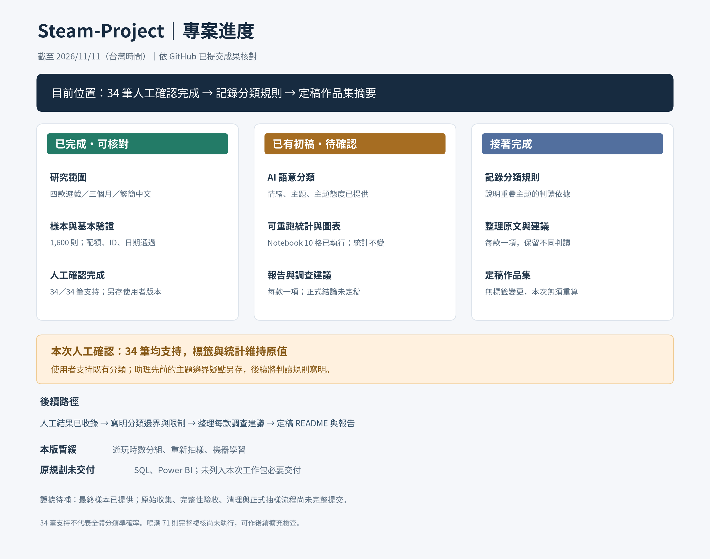

# Steam-Project｜目前進度總覽

更新日期：2026/11/11（台灣時間）。依 GitHub 已提交檔案與現有工作包核對。

**目前位置：34 筆抽查已由使用者人工確認，全部支持既有分類；正在整理分類方法與正式作品集摘要。**

[查看人工確認檔與驗證結果](../deliverables/steam_analysis_v02/human_review/README.md)。原統計不變，正式研究結論尚未定稿。

## 目前版本要完成什麼

1. 說明各款遊戲評論者主要肯定與批評哪些體驗。
2. 每款提出一項有數據與原文支持的優先調查事項。

研究期間：台灣時間 2026/08/01–2026/10/31；Steam 繁簡中文評論 1,600 則。配額為 Overwatch 500、Apex Legends 500、鳴潮 300、燕雲十六聲 300。面向占比以各款全部樣本為分母，同評論同主題只計一次。

## 交付狀態與證據

| 工作階段 | 目前狀態 | GitHub 已有成果／仍缺什麼 |
| --- | --- | --- |
| 研究範圍與問題 | 已確定 | 四款遊戲、三個月、繁簡中文；以體驗與優先調查為核心。 |
| 資料蒐集、清理與抽樣 | 已提供結果；流程待補證據 | 使用者表示已完成；[CSV](../deliverables/steam_analysis_v02/steam_chinese_1600_semantic_v02.csv) 已提交。原始分頁、收集完整性紀錄、清理與正式抽樣程式尚未見於 GitHub，不能僅由最終 CSV 驗收整個流程。 |
| 分析資料驗證 | 已完成本版檢查 | [驗證結果](../deliverables/steam_analysis_v02/results/validation.json)：1,600 筆、配額相符、評論 ID 唯一、必要欄位與建立日期通過；9 則研究期後更新另作敏感度分析。 |
| AI 初步語意分類 | 已有初判 | 情緒、主題與各主題態度已提供；原始 CSV 的狀態是歷史值，本次 34 筆人工確認另存版本，不批次改成全體已驗證。 |
| 主題統計與圖表 | 已完成初稿 | [主要批評面向](../deliverables/steam_analysis_v02/results/criticism.png)、[正反回饋並列](../deliverables/steam_analysis_v02/results/feedback.png)、完整統計 CSV 已提交；數字仍依 AI 初判。 |
| 原文案例抽查 | 使用者人工確認完成 | [人工版本](../deliverables/steam_analysis_v02/human_review/review_check_all_34_human_v01.csv)：24 筆主抽查＋10 筆補查，34／34 均支持；不將此數字稱為全體分類準確率。 |
| 分類邊界與標籤修正 | 本次未要求改標；規則待記錄 | 使用者支持既有標籤，助理先前的邊界疑點另存。需將人工採用的分類規則寫明；鳴潮 71 則完整複核是可擴充檢查，尚未執行。 |
| 人工確認後統計核對 | 已核對，數值維持 | 34 筆人工主題態度與原 AI 相同，沒有標籤變更，因此沒有重算必要；筆數、比例、排名及統計圖不變。 |
| 優先調查建議 | 每款一項初稿 | [調查摘要表](../deliverables/steam_analysis_v02/results/investigation_summary.csv) 有面向數據、原文案例及下一個查證動作；不是修復排序，也未驗證 Bug。 |
| Notebook 與分析文件 | 已提交 | [Notebook](../deliverables/steam_analysis_v02/Steam_Experience_Analysis_v02.ipynb) 的 10 個程式格均有執行紀錄與輸出；[分析報告](../deliverables/steam_analysis_v02/results/analysis_report.md)、[README 摘要初稿](../deliverables/steam_analysis_v02/results/README_summary.md) 已提交。Notebook 在雲端 Python kernel 驗證，尚未在 Colab 服務內實測。 |
| 正式作品集結論 | 待定稿 | 需根據人工確認結果修正內容，再完成正式圖表、結論與 README 成果敘述。 |

不提供整體完成百分比，因各階段工作量不同，且分類品質尚未驗收。

## 本版下一步

1. 將人工判讀採用的分類邊界寫成方法說明，說明抽卡、介面與內容養成是否可同時標記。
2. 依既有數據及原文證據整理每款一項優先調查建議；將使用者支持與助理疑點分別記錄。
3. 定稿作品集摘要，註明已完成 24＋10 筆抽查的人工確認，不把它外推成整體準確率。
4. 補資料取得／清理／正式抽樣的可重現紀錄；如要擴充品質檢查，再複核其他評論。

抽查不能推估全體分類準確率，面向總筆數也不能當作掉線、材料解鎖、新手受辱等細項問題筆數。

## 延後與原規劃項目

| 項目 | 目前安排 |
| --- | --- |
| 遊玩時數分組、重新抽樣、機器學習 | 本版暫緩；34 筆品質抽查不屬於重新抽研究樣本。平均時數圖可保留在使用者原有 EDA 紀錄，GitHub 尚未見該圖。 |
| SQL 分析 | 原計畫包含，目前尚無已提交的專案 SQL 查詢；不是本次工作包的必要交付。環境測試用 SQLite 不算研究 SQL 分析完成。 |
| Power BI 儀表板 | 原計畫包含，目前尚未提交；不是本次工作包的必要交付。 |
| 每款三項建議 | 原計畫目標；目前版本先完成每款一項有證據支持的調查事項。 |

## 快速入口

- [下載含人工確認的成果 ZIP](../deliverables/Steam_Experience_Analysis_v02_human_review_v01.zip)：在 GitHub 檔案頁點 Download raw file。
- [閱讀完整分析報告](../deliverables/steam_analysis_v02/results/analysis_report.md)
- [閱讀 README 成果摘要初稿](../deliverables/steam_analysis_v02/results/README_summary.md)
- [瀏覽全部分析成果](../deliverables/steam_analysis_v02/)

本頁是進度索引；34 筆已記錄使用者人工確認，其他未審閱評論不視為全體品質驗收通過。
